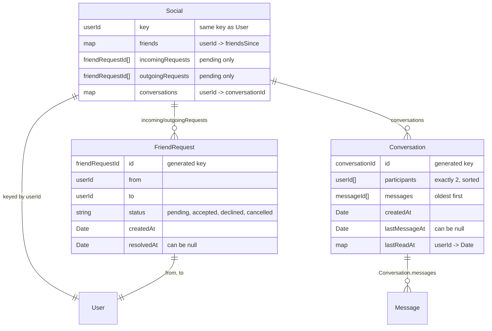

# Friends and Private Messaging: API Spec (T03)

Story 1 (Friends, Messaging, Private Games, and Moderation). Owner: Divya.
Status: done for friends and 1:1 messaging. Invites, private games, blocking,
reporting, moderation, and the verified-only check are listed under "Planned
additions" and are filled in during Sprint 1.

This spec covers the REST routes, socket events, request and response types,
and error messages for friend requests, the friends list, and private
messaging. All types live in `shared/src/friend.types.ts` and
`shared/src/conversation.types.ts`, and the database models are in
`server/src/models.ts` (T02). Frontend tasks (T21, T28, T29) can build against
these types before the backend (T20, T27) is finished.

## Conventions

These follow the existing GameNite API so the new code looks like the old
code.

- **Authentication.** Every request carries `{ auth, payload }` and is checked
  with `withAuth(...)` and `checkAuth` (REST) or `enforceAuth` (sockets),
  exactly like `/api/thread/create`. Because the friends list and messages are
  private, all reads are `POST` requests with auth in the body, the same way
  `/api/user/list` is a `POST`.
- **Users are identified by username.** The client never sees user ids. Friend
  requests are identified by the two usernames involved, not by a request id.
- **Error responses.**
  - Malformed body: status `400`, `{ error: "Poorly-formed request" }`.
  - Bad username/password: status `403`, `{ error: "Invalid credentials" }`.
  - Rule violations (for example, a request to yourself): status `200` with
    `{ error: <message> }`, using the constants in `FRIEND_ERRORS` and
    `CONVERSATION_ERRORS`. This matches `/api/user/signup` and lets client
    services use the existing `if ("error" in res.data) throw ...` pattern.
- **Verified users only (COS 1.1).** Sending a friend request, sending a
  message, and creating a private game first check that the user's email is
  verified. If not, they return the error "Verify your email to use this
  feature," and the client shows the verify prompt. The check itself is built
  in T19 (see `docs/email-verification.md`).
- **Socket errors.** Existing socket handlers only log errors. The new `dm*`
  handlers also emit `dmError` to the socket that made the request, so the
  client can show a message.

## REST routes

### `/api/friend`

| Endpoint           | Payload              | Response             | Description                                        |
| ------------------ | -------------------- | -------------------- | -------------------------------------------------- |
| `/list`            | `null`               | `FriendsOverview`    | Friends, incoming requests, and outgoing requests  |
| `/search`          | search string        | `UserSearchResult[]` | Users whose username starts with the search string |
| `/request/send`    | recipient's username | `FriendsOverview`    | Send a friend request                              |
| `/request/accept`  | sender's username    | `FriendsOverview`    | Accept a pending request                           |
| `/request/decline` | sender's username    | `FriendsOverview`    | Decline a pending request                          |
| `/request/cancel`  | recipient's username | `FriendsOverview`    | Cancel a request you sent                          |
| `/remove`          | friend's username    | `FriendsOverview`    | Remove a friend                                    |

All routes are `POST`. Every action returns the viewer's updated
`FriendsOverview`, so the Friends page can re-render from one response.

**`/search`** (COS 1.2). Payload is validated with `zUserSearchRequest`
(trimmed, 1–100 characters). Matches the start of usernames,
case-insensitively, and returns at most `USER_SEARCH_LIMIT` (20) results
sorted by username. Each result includes the viewer's `relationship` to that
user (`self`, `friend`, `incoming`, `outgoing`, or `none`) so the UI can show
the right button.

**`/request/send`** (COS 1.1, 1.2, 1.3). Checks, in order:

| Check                                        | Error                                   |
| -------------------------------------------- | --------------------------------------- |
| Sender's email isn't verified (T19)          | "Verify your email to use this feature" |
| Recipient doesn't exist                      | `FRIEND_ERRORS.userNotFound`            |
| Recipient is the sender                      | `FRIEND_ERRORS.selfRequest`             |
| Already friends                              | `FRIEND_ERRORS.alreadyFriends`          |
| A pending request exists in either direction | `FRIEND_ERRORS.pendingRequestExists`    |
| Recipient has blocked the sender (T32)       | `FRIEND_ERRORS.userNotFound`            |

On any error, nothing is saved. On success, a `FriendRequest` record is
created with status `pending`, its id is added to the sender's
`outgoingRequests` and the recipient's `incomingRequests`, and
`friendsUpdated` is sent to both users.

A blocked request returns the same "User not found" error as a missing user,
so the sender can't tell that they've been blocked.

**`/request/accept`** (COS 1.2). Error `noIncomingRequest` if there's no
pending request from that user. On success, the request's status becomes
`accepted`, it is removed from both users' request lists, each user is added
to the other's `friends` with the current time, and `friendsUpdated` is sent
to both.

**`/request/decline`** (COS 1.2). Error `noIncomingRequest` if there's no
pending request from that user. On success, the status becomes `declined` and
the request is removed from both lists. No notification is sent to the sender;
see "Decisions for review" below.

**`/request/cancel`** (COS 1.2). Error `noOutgoingRequest` if the viewer has
no pending request to that user. On success, the status becomes `cancelled`,
the request is removed from both lists, and `friendsUpdated` is sent to both.

**`/remove`** (COS 1.4). Error `notFriends` if they aren't friends. On
success, each user is removed from the other's `friends`, and `friendsUpdated`
is sent to both. Their conversation is kept, so both users can still read the
history, but new messages are rejected.

### `/api/conversation`

| Endpoint   | Payload                      | Response                  | Description                                     |
| ---------- | ---------------------------- | ------------------------- | ----------------------------------------------- |
| `/list`    | `null`                       | `ConversationSummary[]`   | Messages inbox, most recent first               |
| `/open`    | friend's username            | `ConversationInfo`        | Open (or create) the conversation with a friend |
| `/history` | `ConversationHistoryRequest` | `ConversationHistoryPage` | Load older messages                             |

All routes are `POST`.

**`/list`** (COS 1.6). Returns every conversation the viewer is in, sorted by
`lastMessageAt` (falling back to `createdAt` for conversations with no
messages), newest first. Each summary includes the last message and the
viewer's unread count.

**`/open`** (COS 1.6). Errors: `CONVERSATION_ERRORS.userNotFound` if the user
doesn't exist; `notFriends` if they aren't friends and no conversation exists
yet. If a conversation already exists, it is returned even after the two stop
being friends, with `canSend: false`. Otherwise a new conversation is created
and its id is stored in both users' `conversations`. The response includes the
newest page of messages (up to `CONVERSATION_PAGE_SIZE`, oldest first).

**`/history`** (COS 1.6). Payload is validated with
`zConversationHistoryRequest`. `before` is a message id; the response contains
up to `limit` (default and max 50) messages older than it, oldest first.
Errors: `conversationNotFound` if the conversation doesn't exist **or** the
viewer isn't a participant, so the response doesn't reveal which conversations
exist.

## Socket events

Real-time delivery uses a private room per user (`user:<userId>`, server-side
only). Each tab joins its user's room with `socialSubscribe` after login. The
server then emits to the room, so every open tab of that user gets the same
events. This is what keeps unread counts in sync across tabs (major unknown
#1): the server owns the count and pushes changes to every tab.

The event names and payload types below are added to
`shared/src/socket.types.ts` with the backend work (T20 and T27); the payload
types already exist in `shared/src/conversation.types.ts` (T02).

### Client to server

| Event             | Payload                              | Description                                 |
| ----------------- | ------------------------------------ | ------------------------------------------- |
| `socialSubscribe` | `WithAuth<null>`                     | Join this socket to the user's private room |
| `dmSend`          | `WithAuth<SendDirectMessagePayload>` | Send a private message                      |
| `dmMarkRead`      | `WithAuth<string>` (conversation id) | Mark the conversation as read for this user |

**`dmSend`** (COS 1.6, 1.9). Validated with `zSendDirectMessagePayload`, which
rejects empty, whitespace-only, and over-1,000-character text. The server then
checks that the sender is verified, is a participant, and is still friends
with the other user. Next, the text goes through moderation (COS 1.9, built in
T33): a flagged message is not saved to the conversation or delivered, and the
sender gets `dmError` with the reason. On success, a `Message` record is saved
(reusing the existing model), its id is appended to the conversation,
`lastMessageAt` is updated, and `dmNewMessage` is emitted to both users'
rooms. The recipient's tabs also get `dmReadUpdated` with their new unread
count.

| Problem                                           | `dmError.error`                                                       |
| ------------------------------------------------- | --------------------------------------------------------------------- |
| Text empty or whitespace-only                     | `CONVERSATION_ERRORS.emptyMessage`                                    |
| Text over 1,000 characters                        | `CONVERSATION_ERRORS.messageTooLong`                                  |
| Conversation missing, or sender not a participant | `CONVERSATION_ERRORS.conversationNotFound`                            |
| No longer friends (including after a block)       | `CONVERSATION_ERRORS.notFriends`                                      |
| Sender's email isn't verified (T19)               | "Verify your email to use this feature"                               |
| Flagged by moderation (T33)                       | The moderation reason, e.g. "This message was flagged for harassment" |

**`dmMarkRead`** (COS 1.12, Desirable). Sets the viewer's `lastReadAt` for the
conversation to now and emits `dmReadUpdated` with `unreadCount: 0` to the
viewer's room. Errors as for `dmSend` (`conversationNotFound`).

### Server to client

| Event            | Payload                     | Sent to                              |
| ---------------- | --------------------------- | ------------------------------------ |
| `dmNewMessage`   | `DirectMessageNewPayload`   | Both participants' rooms             |
| `dmReadUpdated`  | `DirectMessageReadPayload`  | That user's room                     |
| `dmError`        | `DirectMessageErrorPayload` | Only the socket whose request failed |
| `friendsUpdated` | `FriendsOverview`           | That user's room                     |

The client filters `dmNewMessage` by `conversationId`: an open chat window
appends the message, and the inbox moves that conversation to the top.

## Planned additions (Sprint 1)

The revised Story 1 adds these. Each one gets its routes, events, and error
messages added to this spec in Sprint 1, before its backend task starts, using
the same conventions as above.

| COS | Addition             | Spec outline                                                                                                   | Built in |
| --- | -------------------- | -------------------------------------------------------------------------------------------------------------- | -------- |
| 1.1 | Email verification   | `/api/auth/verify-email`, `/api/auth/resend-verification`; the verified-only check described above             | T19      |
| 1.4 | Live friend activity | `friendActivity` event (Offline, Online, In a lobby for a game, Playing a game) sent only to friends' rooms    | T29      |
| 1.5 | Game invites         | `/api/friend/invite`; `inviteReceived`, `inviteAnswered`, and `inviteExpired` events; 2-minute expiry          | T30      |
| 1.7 | Private games        | `private` flag and room code on game creation; join by invite or code; host removes a player, who can't rejoin | T31      |
| 1.8 | Block and report     | `/api/friend/block`, `/api/friend/unblock`, `/api/report` (user or message, with a reason)                     | T32      |
| 1.9 | Moderation           | Check inside `dmSend` (above); fallback word filter if the service is down                                     | T33      |

## Data model (T02)

The records are defined in `server/src/models.ts` (T02). Their repos
(`SocialRepo`, `FriendRequestRepo`, `ConversationRepo`) are registered in
`server/src/repository.ts` and cleared in `resetEverythingToDefaults` as part
of the backend tasks (T20 and T27). A user with no `Social` record is treated
as having no friends, requests, or conversations, so existing seed users need
no migration.

## Decisions for review

1. **No separate Friendship or DirectMessage model.** The project plan listed
   `Friendship` and `DirectMessage`. The database is a key-value store with no
   queries or deletes, so friendships are stored on both users' `Social`
   records (one lookup to check "are A and B friends?"), and private messages
   reuse the existing `Message` model and `MessageInfo` type. Reusing
   `MessageInfo` also lets T28 reuse `MessageList`.
2. **Per-user rooms instead of per-conversation rooms.** The plan's T17 spike
   was written around per-conversation rooms. Per-user rooms handle the inbox,
   notifications, and multiple tabs with one mechanism, and there's no
   join/leave step for each chat window. T17 should confirm this works before
   T27 is split up.
3. **Rule violations return status 200 with `{ error }`.** This matches
   `/api/user/signup` and the client's existing error check. The alternative
   is 4xx codes, which would need a small change to the client services.
4. **Declined requests disappear silently.** The sender's outgoing request is
   removed from their list when it's declined, with no notification. COS 1.2
   says the sender isn't notified, but they can tell the request is gone. An
   alternative is to keep showing it as pending to the sender. We should agree
   on one.
5. **History stays readable after removing a friend.** COS 1.4 only blocks new
   messages. If the team prefers hiding the conversation, `/list` and `/open`
   would filter it out instead.
6. **Updates to two records aren't atomic.** Accepting a request updates both
   users' `Social` records separately, since Keyv has no transactions. This is
   acceptable at our scale, but it's worth listing under known limitations in
   T71.
